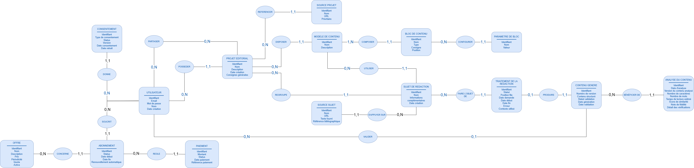
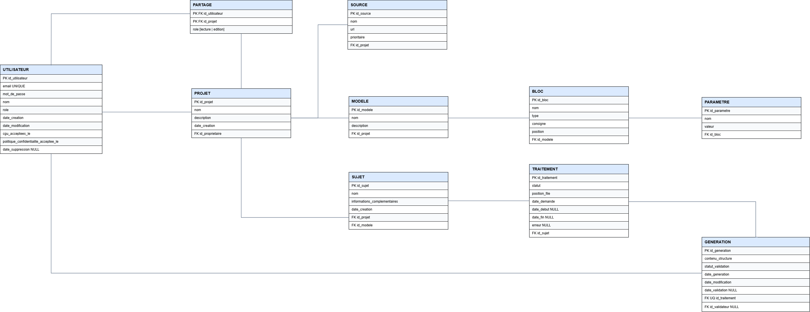
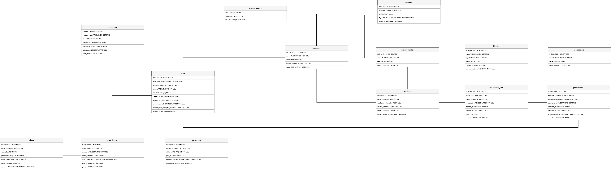
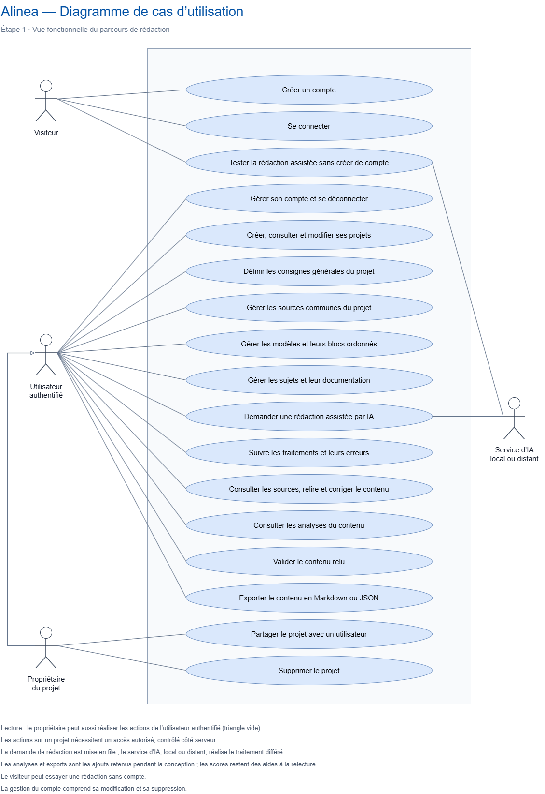
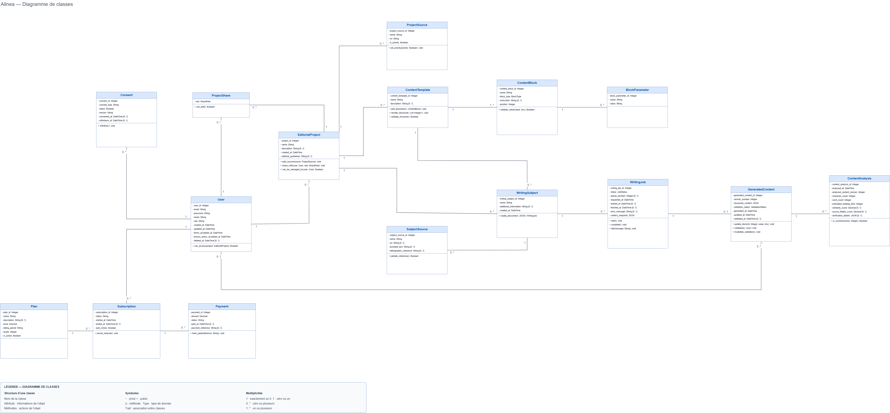
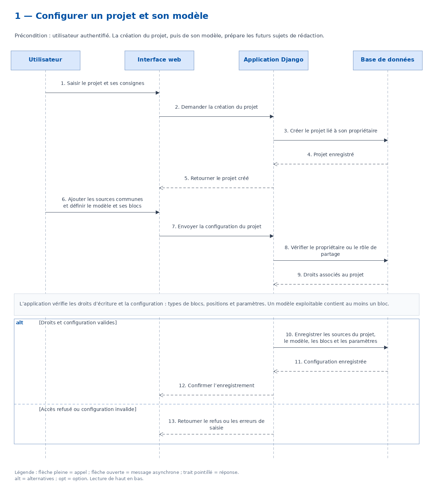
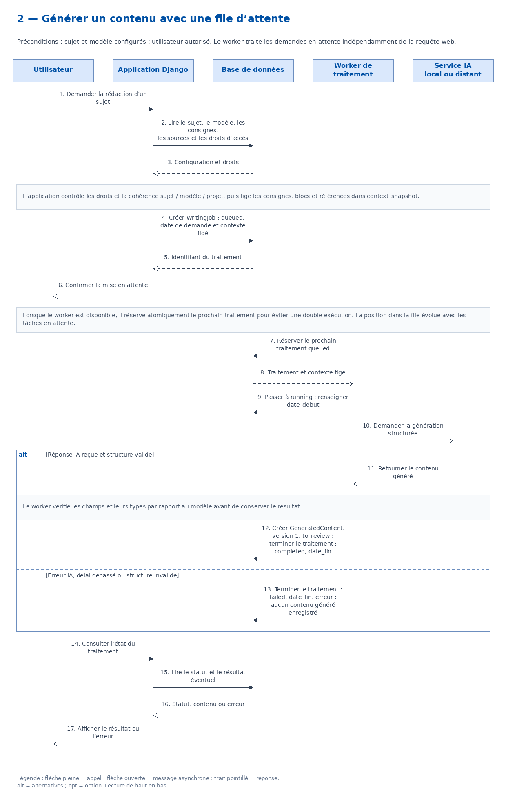
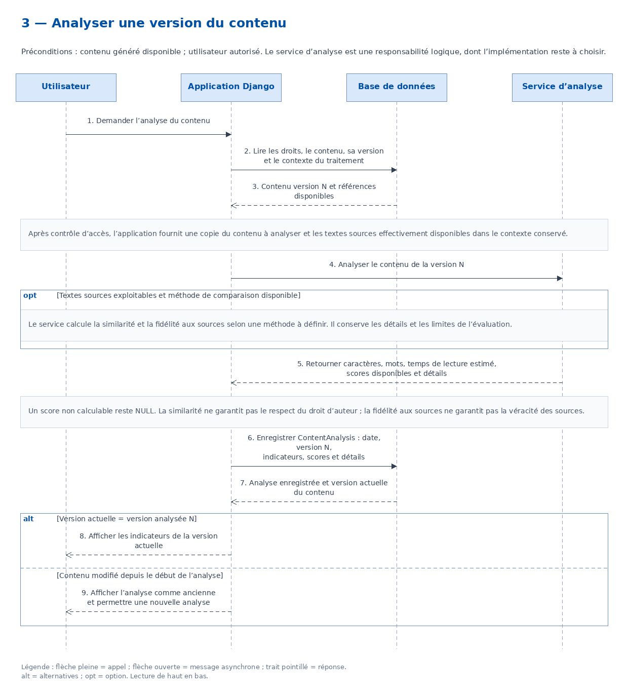
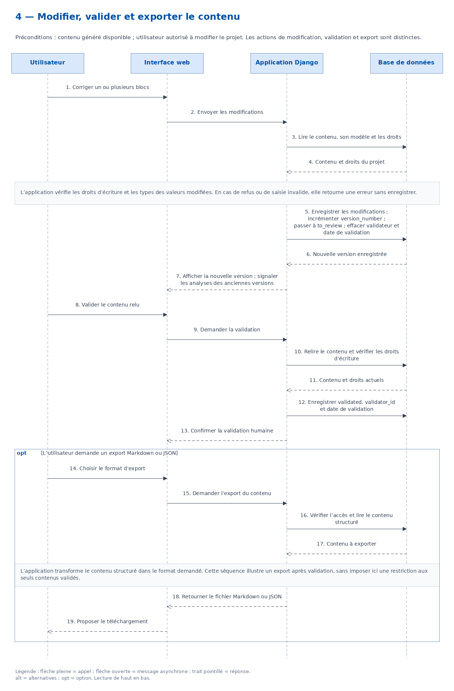

# Alinea
  
  
**Application de production de contenus structurés assistée par intelligence artificielle.**

Alinea est un projet visant à faciliter la production de contenus lorsque ceux-ci suivent une structure et des règles communes.

L'idée est d'utiliser un modèle de langage pour préparer une partie du travail, tout en conservant des sources identifiables et une validation humaine du résultat.

---

## Présentation de l'idée

La création de contenu pour un site web peut demander beaucoup de temps, en particulier lorsqu'un grand nombre de pages doit respecter la même structure.

Pour produire une page, il peut par exemple être nécessaire de rechercher des informations, consulter plusieurs sources, respecter des règles éditoriales, rédiger différents champs puis vérifier le résultat avant publication.

Ce besoin peut être particulièrement présent sur des sites ayant beaucoup de contenu et travaillant leur **référencement naturel (SEO)**.

Les outils d'intelligence artificielle peuvent aider à réaliser une partie de ce travail. Cependant, dans une utilisation classique, il faut souvent redonner les mêmes informations : le contexte, les règles à respecter, les sources à privilégier et la forme du résultat attendu.

Alinea part donc d'une idée simple : **définir ce cadre une fois dans l'application et pouvoir le réutiliser pour plusieurs contenus**.

Un projet Alinea pourrait ainsi contenir :

- des règles éditoriales ;
- des sources à privilégier ;
- un ou plusieurs modèles de contenu ;
- les documents à produire.

---

## Des modèles adaptés au contenu attendu

Tous les contenus ne se présentent pas sous la forme d'un simple article.

Un site peut par exemple disposer d'un espace d'administration dans lequel une fiche est répartie entre de nombreux champs : titre, introduction, description, caractéristiques, nombres, listes, choix prédéfinis, sources, etc.

Alinea permet de créer un modèle qui reprend cette structure.

Un modèle est composé de **blocs typés**, par exemple :

- texte ;
- texte long ;
- nombre ;
- booléen ;
- liste ;
- choix.

L'utilisateur peut ainsi définir les informations qu'il souhaite obtenir et leur organisation.

Par exemple, si un espace d'administration contient dix champs à renseigner, il est possible de créer un modèle Alinea avec les mêmes champs et dans le même ordre.

Le modèle peut ensuite être réutilisé pour plusieurs documents.

L'objectif est que le contenu préparé soit déjà séparé et organisé selon la structure attendue, afin de limiter le travail de remise en forme.

---

## Fonctionnement envisagé

Pour préparer un document, Alinea utilise le modèle choisi ainsi que les règles et les sources définies pour le projet.

Ces éléments servent de contexte au modèle de langage chargé de proposer le contenu des différents blocs.

Plusieurs documents pourront être placés dans une file de traitement afin d'être préparés successivement, sans devoir relancer manuellement chaque génération.

Une fois un traitement terminé, l'utilisateur retrouve le contenu organisé selon son modèle.

Il peut alors **relire, modifier et valider** les différents éléments avant de les utiliser.

L'IA reste donc une aide à la préparation du contenu. Le résultat n'est pas considéré comme validé automatiquement.

---

## Problématique

Produire un grand nombre de contenus qui suivent une structure similaire peut rapidement devenir répétitif et chronophage.

Pour chaque contenu, il faut retrouver les informations nécessaires, consulter les sources adaptées, respecter les mêmes règles éditoriales, renseigner les différents champs attendus puis vérifier le résultat. Lorsque ce travail doit être répété sur des dizaines ou des centaines de documents, il devient difficile de conserver un processus à la fois efficace et cohérent.

Les modèles de langage peuvent aider à automatiser une partie de ces tâches, mais leur utilisation pose aussi la question du respect des consignes, de la fiabilité des informations produites et du contrôle sur le résultat.

La problématique du projet est donc :

> **Comment automatiser une partie de la production de contenus structurés tout en conservant des règles communes, des sources identifiables et un contrôle humain sur le résultat ?**

---

## Objectif du projet

L'objectif d'Alinea est de développer une application permettant d'organiser ce processus de production.

Le projet prévoit notamment de permettre à l'utilisateur de :

- créer et gérer des projets ;
- définir des règles éditoriales ;
- enregistrer des sources de référence ;
- créer des modèles de contenu ;
- composer ces modèles avec différents types de blocs ;
- créer des documents à partir d'un modèle ;
- utiliser un modèle de langage pour préparer le contenu des blocs ;
- traiter plusieurs documents successivement ;
- retrouver les sources utilisées ;
- relire et modifier les propositions ;
- valider manuellement le résultat final.

Le projet cherchera ainsi à déterminer dans quelle mesure ce fonctionnement peut **réduire les tâches répétitives liées à la production de contenus**, sans supprimer le contrôle de l'utilisateur.

---

## MCD - Modèle Conceptuel de Données

Le modèle conceptuel de données représente les principales entités nécessaires au fonctionnement d’Alinea et leurs relations. Un utilisateur peut créer et partager des projets. Chaque projet regroupe ses sources, ses modèles de contenu et les sujets à traiter. Les modèles sont composés de blocs configurables à l’aide de paramètres. Un sujet peut ensuite faire l’objet d’un ou plusieurs traitements, dont l’exécution peut produire une génération structurée.

## MLD - Modèle Logique de Données

Le modèle logique de données traduit le MCD d’Alinea en une structure relationnelle et prépare l’organisation de la future base de données.

Il couvre la gestion des utilisateurs et des informations nécessaires au respect du RGPD, ainsi que la création, la propriété et le partage des projets. Chaque projet peut regrouper ses propres sources, modèles de contenu et sujets à traiter.

Les modèles sont composés de blocs configurables à l’aide de paramètres. Les sujets sont ensuite associés à un modèle et peuvent être placés dans la file de traitement. Chaque traitement conserve son état et les informations liées à son exécution, puis peut aboutir à une génération structurée soumise à une validation humaine.

## MPD - Modèle Physique de Données

Le modèle physique de données traduit le MLD en une structure adaptée à la future base de données de l'application.

Il précise les types de données, les clés primaires et étrangères ainsi que les principales contraintes nécessaires à l'implémentation.

## UML - Diagramme de cas d’utilisation

Le diagramme de cas d’utilisation présente les principales fonctionnalités d’Alinea et les acteurs qui interagissent avec l’application : visiteur, utilisateur authentifié, propriétaire de projet et service d’IA.

Il couvre l’essai sans compte, la configuration des projets et des modèles, la rédaction assistée, le suivi des traitements, l’analyse, la relecture, la validation et l’export des contenus.

## UML - Diagramme de classes

Le diagramme de classes présente la structure métier d’Alinea : utilisateurs, projets éditoriaux, modèles de contenu, sujets de rédaction, traitements, contenus générés et analyses.

Chaque classe décrit les informations qu’elle contient (attributs) et les actions qu’elle propose (méthodes). Les associations et leurs multiplicités précisent les relations entre les objets : un utilisateur peut posséder plusieurs projets, tandis que chaque projet possède un seul propriétaire.

Ce diagramme complète la modélisation des données en préparant l’organisation du code en programmation orientée objet. Les méthodes représentent les responsabilités envisagées et pourront être ajustées lors du développement.

## UML - Diagrammes de séquence

Les diagrammes de séquence présentent les échanges entre l’utilisateur, l’application et les services impliqués dans les principaux parcours d’Alinea. Ils décrivent l’ordre des actions, les réponses et les principaux cas d’erreur.

### Configuration du projet et du modèle

Ce diagramme décrit la création d’un projet, puis l’enregistrement de ses sources et de son modèle de contenu, avec vérification des droits et des données.

### Génération d’un contenu

Ce diagramme présente la mise en attente d’une rédaction, sa prise en charge par le worker et les échanges avec le service IA local ou distant, jusqu’à l’enregistrement du contenu ou d’une erreur.

### Analyse du contenu

Ce diagramme décrit l’analyse d’une version du contenu, l’enregistrement des indicateurs et la distinction entre une analyse actuelle et une analyse devenue ancienne après modification du texte.

### Modification, validation et export

Ce diagramme présente la correction du contenu, la mise à jour de sa version, sa validation humaine et son export en Markdown ou JSON.

Les diagrammes se lisent de haut en bas. Les cadres `alt` représentent les alternatives et les cadres `opt` les étapes facultatives.

Le fichier [DS.drawio](docs/uml/DS.drawio) regroupe les quatre diagrammes dans des onglets distincts.

## Conception des interfaces

Les interfaces d’Alinea ont été conçues en trois étapes : le zoning pour répartir les grandes zones, les wireframes pour organiser les éléments et les mockups pour définir leur apparence.

Les exemples suivants présentent une sélection d’écrans dans leurs versions desktop et mobile.

### Zoning — Accueil

Le zoning définit les principales zones de la page d’accueil : navigation, présentation du produit et mise en avant de ses fonctionnalités.

<table>
  <tr>
    <th width="75%">Desktop</th>
    <th width="25%">Mobile</th>
  </tr>
  <tr>
    <td valign="top">
      
    </td>
    <td valign="top">
      
    </td>
  </tr>
</table>

### Wireframe — Éditeur de modèle

Le wireframe précise l’organisation de l’éditeur, notamment la composition du modèle, l’ajout de blocs typés et la configuration de leurs paramètres.

<table>
  <tr>
    <th width="75%">Desktop</th>
    <th width="25%">Mobile</th>
  </tr>
  <tr>
    <td valign="top">
      
    </td>
    <td valign="top">
      
    </td>
  </tr>
</table>

### Mockup — Accueil

La maquette de la page d’accueil applique la charte graphique et présente la proposition de valeur d’Alinea.

<table>
  <tr>
    <th width="75%">Desktop</th>
    <th width="25%">Mobile</th>
  </tr>
  <tr>
    <td valign="top">
      
    </td>
    <td valign="top">
      
    </td>
  </tr>
</table>

### Mockup — Résultat et relecture

Cet écran présente le contenu généré, les sources et les indicateurs associés. Il permet à l’utilisateur de relire et de modifier le résultat avant sa validation et son export.

<table>
  <tr>
    <th width="75%">Desktop</th>
    <th width="25%">Mobile</th>
  </tr>
  <tr>
    <td valign="top">
      
    </td>
    <td valign="top">
      
    </td>
  </tr>
</table>

L’ensemble des écrans est disponible dans le dossier [Maquettes](docs/maquettes).

## Architecture et choix techniques

### Technologies retenues

Les choix techniques d’Alinea répondent aux besoins du projet : gérer des comptes et des projets éditoriaux, produire des contenus structurés avec une IA, conserver les résultats et permettre leur validation humaine.

| Technologie | Utilisation |
|---|---|
| **Python et Django** | Fonctionnalités serveur, authentification, formulaires, ORM et migrations. |
| **Templates Django, HTML, CSS et JavaScript** | Construction des pages, présentation responsive et interactions utilisateur. |
| **PostgreSQL** | Stockage des données relationnelles et des contenus structurés en JSONB. |
| **Docker et Docker Compose** | Configuration et exécution des services dans des conteneurs. |
| **pytest, pytest-django et coverage** | Tests des règles métier, des données et des autorisations, avec mesure de couverture. |
| **Ruff et pre-commit** | Contrôle du code Python, formatage et vérifications avant les commits. |
| **SonarQube** | Analyse complémentaire de la maintenabilité, des duplications et de certains problèmes de sécurité. |
| **Git, GitHub et GitHub Actions** | Versionnement, suivi du travail et automatisation des contrôles, des tests et des étapes de livraison. |

### Comparaison des solutions possibles

**Framework serveur : Django et Symfony**

Symfony constitue une alternative pour développer Alinea en PHP, avec des composants pour l’authentification, les formulaires et la gestion des données avec Doctrine. Je retiens Django pour développer l’application en Python et disposer de l’authentification, des formulaires, de l’ORM et des migrations dans un même framework. Ce choix correspond à l’organisation retenue pour les fonctionnalités web et les traitements de rédaction.

**Interface : templates Django et frontend React séparé**

Un frontend React séparé permet de construire une interface communiquant avec le serveur par une API. Pour le MVP, je retiens les templates Django afin de conserver les pages et leurs traitements dans un même projet. HTML, CSS et JavaScript couvrent les interactions nécessaires sans ajouter une application frontend distincte et ses échanges avec une API à maintenir.

**Base de données : PostgreSQL et MySQL**

PostgreSQL et MySQL permettent tous deux de représenter les relations entre les données, d’appliquer des contraintes d’intégrité et de stocker du JSON. Je retiens PostgreSQL pour associer le modèle relationnel d’Alinea au stockage des contenus structurés en JSONB. Le MPD est établi pour cette base et la même technologie est retenue en développement et en production.

**Environnement : installation directe et Docker Compose**

Une installation directe dans WSL permet de lancer l’application et PostgreSQL. Je retiens Docker Compose pour décrire les services, leurs dépendances, leurs réseaux et leurs volumes dans une configuration versionnée. Cette organisation facilite la reproduction de l’environnement et l’ajout du worker de rédaction.

### Architecture générale

Alinea repose sur une architecture monolithique modulaire. Les pages web, l’authentification et les fonctionnalités métier sont regroupées dans un même projet Django, organisé en modules selon leurs responsabilités : comptes, projets éditoriaux, modèles de contenu, rédaction et analyses.

Cette organisation permet de développer chaque fonctionnalité de bout en bout dans une même application : interface, traitement serveur et accès aux données. Elle convient à un développement individuel et limite le nombre de composants à maintenir indépendamment.

Les générations sont exécutées par un worker distinct du processus web. L’application et le worker partagent le code métier et la base de données PostgreSQL. Une file persistante conserve les demandes et permet leur exécution successive sans bloquer la navigation.

### Organisation du dépôt : monorepo

Je retiens une organisation en monorepo : un dépôt Git unique regroupe le code de l’application, celui du worker, les tests, la documentation, les fichiers Docker et les workflows GitHub Actions.

Une même pull request peut ainsi réunir les modifications nécessaires à une fonctionnalité : code métier, interface, migrations, tests et documentation.

Des dépôts séparés permettent de gérer des composants ayant des cycles de livraison indépendants. Pour Alinea, les composants partagent les mêmes règles métier et évoluent ensemble. Le dépôt unique facilite donc le suivi des changements et la cohérence des versions.

Le monorepo décrit l’organisation du code source, tandis que l’architecture monolithique modulaire décrit l’organisation de l’application.

### Organisation du code

L’application suit l’organisation MVT de Django : Model, View, Template.

| Élément | Responsabilité |
|---|---|
| **Modèles** | Représenter les données, leurs relations et leurs contraintes. |
| **Vues** | Recevoir les requêtes, contrôler les autorisations, appeler les traitements nécessaires et préparer les réponses. |
| **Templates** | Construire les pages HTML à partir des données fournies par les vues. |

Le routage associe les URL aux vues. Les formulaires contrôlent les données saisies côté serveur. L’ORM assure les échanges avec PostgreSQL et les migrations font évoluer la structure de la base.

Les traitements métier complexes sont regroupés dans des services dédiés, notamment pour préparer le contexte de rédaction, communiquer avec le service IA et analyser les contenus. Ces services sont réutilisables par les vues et par le worker.

Cette séparation garde les vues centrées sur les requêtes et les réponses et facilite les tests des règles métier indépendamment de l’interface.

### Intégration de l’intelligence artificielle

Alinea utilise un modèle existant accessible par un service local ou distant. L’utilisateur configure et teste sa connexion depuis une page dédiée. Le service proposé par Alinea possède sa propre configuration côté serveur, notamment pour l’essai sans compte.

Les appels au service IA sont regroupés dans une couche dédiée pour séparer les particularités de connexion des règles métier. Les secrets de connexion ne sont pas inclus dans les contextes consultables des traitements.

Pour chaque rédaction, l’application rassemble les consignes du projet, la structure du modèle, les informations du sujet et les sources disponibles. Les textes fournis sont intégrés au contexte ; le contenu des pages web est récupéré avant de pouvoir être transmis au modèle.

Le worker prend en charge la demande, transmet le contexte au service IA, contrôle la structure et les types de la réponse, puis enregistre le contenu ou l’erreur.

Le traitement conserve son état, ses dates d’exécution et le contexte transmis. Le contenu généré reste soumis à une relecture et à une validation humaine explicite.

### Environnement de développement et hébergement

Le développement s’effectue sous Windows avec WSL. Le dépôt est placé dans le système de fichiers Linux de WSL.

Docker Compose définit des services distincts pour l’application web, PostgreSQL et le worker. Le code est monté dans les conteneurs de développement pour permettre les modifications sans reconstruire l’image à chaque changement de code. Un volume persistant conserve les données de PostgreSQL entre les redémarrages ordinaires.

Les paramètres de configuration sont fournis par des variables d’environnement. Les secrets sont conservés dans un fichier local exclu du dépôt Git. Un fichier d’exemple documente les variables nécessaires sans exposer leurs valeurs confidentielles.

La cible de déploiement est une machine virtuelle sur mon serveur personnel, avec un reverse proxy pour exposer l’application en HTTPS. Les configurations de développement et de production sont distinctes, notamment pour les secrets, les accès réseau et les paramètres de sécurité.

Ce choix permet de réutiliser mon infrastructure et implique la prise en charge des mises à jour, des sauvegardes et de la supervision.