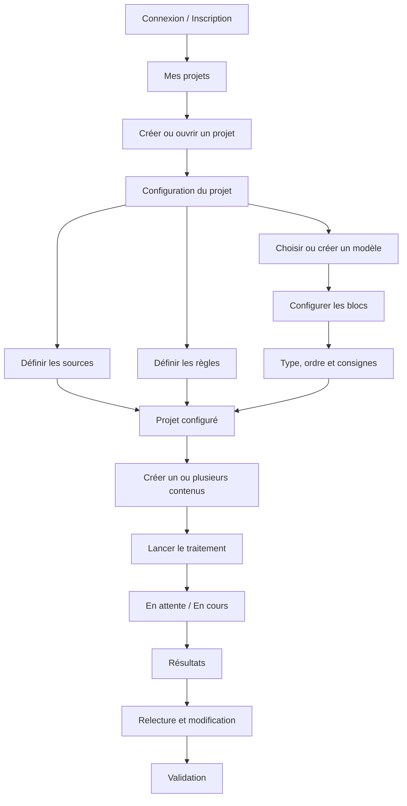
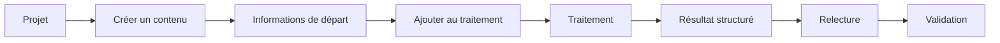
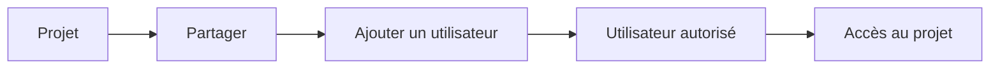

# Parcours utilisateurs — Alinea

Ce document présente les principaux parcours utilisateurs et l'enchaînement des écrans d'Alinea.

---

## Parcours principal

Le fonctionnement d'Alinea s'organise autour d'un projet.

L'utilisateur configure d'abord le cadre dans lequel ses contenus seront produits, puis crée les contenus à traiter.



---

## Configuration d'un projet

Lors de la création d'un projet, l'utilisateur définit les éléments qui seront réutilisés pour produire ses contenus.

```text
Projet
│
├── Modèle de contenu
│   └── Blocs
│       ├── Nom
│       ├── Type
│       ├── Ordre
│       └── Consignes
│
├── Sources
│
└── Règles
    ├── Ton
    ├── Style
    └── Consignes générales
```

Ces éléments peuvent ensuite être modifiés depuis le projet.

---

## Production des contenus

Une fois le projet configuré, l'utilisateur peut créer les contenus qu'il souhaite faire préparer.



Plusieurs contenus peuvent être ajoutés afin d'être traités successivement.

---

## Relecture et validation

Après le traitement, le résultat est présenté selon la structure du modèle utilisé.

L'utilisateur peut :

- consulter les différents blocs ;
- consulter les sources utilisées ;
- modifier les propositions ;
- valider le résultat.

Le contenu généré n'est pas considéré comme validé avant cette intervention.

---

## Partage d'un projet

Un projet peut être partagé avec un autre utilisateur.



L'utilisateur autorisé retrouve le projet parmi les projets auxquels il a accès.

---

## Enchaînement des écrans principaux

```text
Connexion / Inscription
        ↓
Mes projets
        ↓
Projet
        ├── Configuration
        │      ├── Modèle et blocs
        │      ├── Sources
        │      └── Règles
        │
        ├── Contenus
        │      ↓
        │   Nouveau contenu
        │      ↓
        │   Traitement
        │      ↓
        │   Résultat / Relecture
        │      ↓
        │   Validation
        │
        └── Partage
```